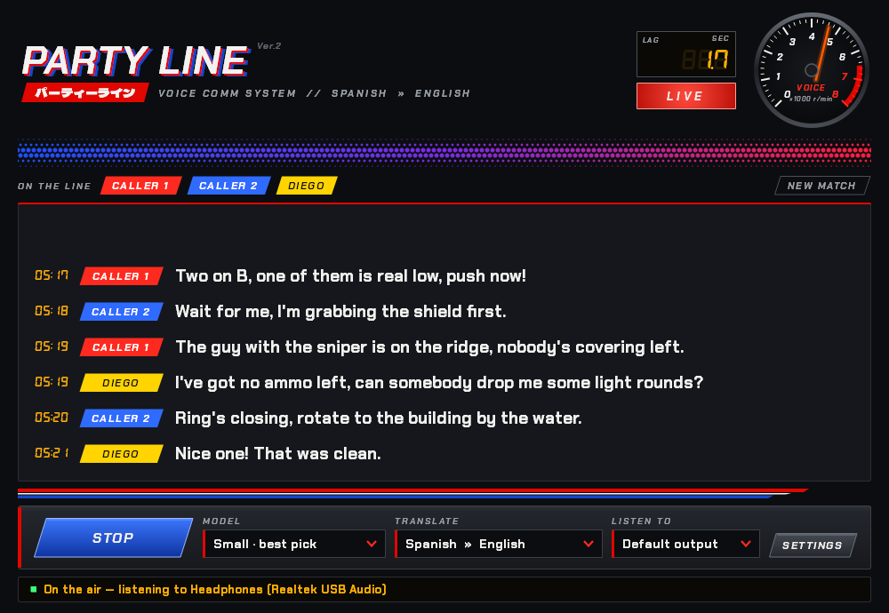

# Party Line: live voice-chat translator

Translates teammates' voice chat (Spanish by default) into English as they speak, and labels
**who** said each line. One window, built for a second monitor while you play fullscreen.



## Using it

1. Double-click **`PartyLine.exe`** (no install). The first launch takes ~10 s to unpack.
   Windows SmartScreen may say "Windows protected your PC" because the app isn't code-signed:
   click **More info → Run anyway**.
2. Drag the window to your second monitor.
3. Click **START LISTENING**. The first time you use a model it downloads it
   (Small ≈ 480 MB); after that it starts in seconds.
4. Play. Spanish lines appear translated, with a coloured tag per voice.

| Control | What it does |
|---|---|
| **START / STOP** | Turns listening on and off. The **LIVE** lamp lights up while it's listening. |
| **Model** | Tiny → Large. Bigger = better translation but more CPU. **Small** is the sweet spot. Switching reloads automatically. |
| **Translate** | Which language to pick out. Anything else (English teammates, noise) is ignored. |
| **Listen to** | Which audio output to listen to. Leave on *System default* unless you route voice chat elsewhere. |
| **Name tags** | Click a caller's tag to rename them. |
| **NEW MATCH** | Clears the transcript and forgets the voices. |
| **SETTINGS** | CPU threads, voice-matching strictness, text size, log folder. |

The **tach** shows the audio level it's hearing: it idles while listening and revs when someone
talks. If the needle never moves during voice chat, pick a different **Listen to** device.
The amber **LAG** readout is how many seconds the last line took to translate.

## Performance

Runs entirely on the **CPU** (4 threads by default) and never touches the graphics card. It only
works while someone is talking. If you see stutter in-game, lower CPU threads in Settings or pick
the Base model.

## Better accuracy: give it only voices (optional)

By default it hears all game audio and filters out gunfire and music. It works better if voice
chat goes to its own device: install [VB-Audio Virtual Cable](https://vb-audio.com/Cable/), then

- **Battlefield 6:** Options → Sound → Voice Chat → output device → `CABLE Input`.
- **Apex Legends:** Control Panel → Sound → Playback → right-click `CABLE Input` →
  **Set as Default Communication Device** (keep your headset as *Default Device*).
- To still hear teammates: Sound → Recording → `CABLE Output` → Properties → Listen →
  *Listen to this device* → your headset.
- In Party Line set **Listen to** → `CABLE Input`.

## Troubleshooting

- Settings → **Open log folder** → `translator.log` has the details of any error.
- `PartyLine.exe --selftest` checks every part (writes PASS/FAIL to the log).
- Settings live in `%APPDATA%\VOIP Translator\settings.json`. Delete it to reset.

## For developers

```
voip_translator/
  audio.py        WASAPI loopback capture + WebRTC VAD utterance splitting
  speakers.py     voiceprints (GE2E encoder as ONNX) + online clustering
  transcriber.py  faster-whisper translate + Silero VAD + language gate
  engine.py       background pipeline → Qt signals
  app.py          the window (late-80s JDM cockpit theme, all artwork drawn in code)
  assets/         fonts (SIL OFL), icon, speaker model
tools/            export_speaker_model.py, make_icon.py, launch.py
PartyLine.spec    PyInstaller build (windowed, one file)
```

Run from source: `pip install -r requirements.txt` then `python -m voip_translator`.
Build the exe on Windows: `build.bat` → `dist\PartyLine.exe`.

Credits: speech by [faster-whisper](https://github.com/SYSTRAN/faster-whisper) (MIT), voiceprints
from [Resemblyzer](https://github.com/resemble-ai/Resemblyzer) (Apache-2.0), fonts Chakra Petch,
Dela Gothic One and DSEG7 (SIL OFL).
