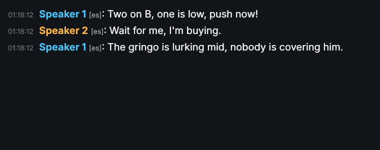

# VOIP Overlay

Live translated captions of your teammates' voice chat, drawn as a click-through strip at the top of the screen.
Each voice is told apart automatically and given its own colour and name.


## How it works

```
game / Discord audio ──► loopback capture ──► VAD (split into utterances)
                                                   │
                       ┌───────────────────────────┴────────────┐
                       ▼                                        ▼
         Whisper "translate" (any lang → English)   ECAPA voice embedding → match to known voices
                       └───────────────────────────┬────────────┘
                                                   ▼
                                   "Speaker 2 [ru]: two on B, one low"
```

| File | Role |
|---|---|
| `voip_overlay/audio.py` | Captures what's playing on an output device (WASAPI loopback) and splits it into utterances with WebRTC VAD |
| `voip_overlay/speakers.py` | Online speaker clustering: assigns each utterance to a known voice or creates a new speaker |
| `voip_overlay/transcriber.py` | faster-whisper speech-to-text + translation, with a filter for Whisper's usual noise hallucinations |
| `voip_overlay/ui.py` | Transparent, always-on-top, click-through PyQt6 caption window |
| `voip_overlay/__main__.py` | CLI and threading (capture → segment → recognise → display) |

## Quick start (Windows, no coding needed)

1. On GitHub, click the green **Code** button → **Download ZIP**. Right-click the ZIP → **Extract All**
   (e.g. to `C:\voip-overlay`).
2. Double-click **`setup.bat`**. It installs Python if needed (if it does, run `setup.bat` a second time), then the
   libraries and speech models. Takes ~5–10 minutes once. If Windows SmartScreen warns you, click
   **More info → Run anyway**.
3. Double-click **`run.bat`** before or during a match. A transcript window opens on monitor 2 and shows only Spanish
   speech, translated to English. Close the black console window to stop.
   - **`run-overlay.bat`** shows a caption strip on top of the game instead (borderless/windowed mode only).

### Performance

Everything runs on the **CPU**, limited to 4 threads, and **never touches your graphics card**. (The speech engine
only supports NVIDIA GPUs anyway.) The CPU only works while someone is talking, in short bursts. If you still see
stutters, edit `run.bat` and add `--cpu-threads 2` (slower captions) or `--model base` (faster, less accurate).

### Hearing only voices (optional, big accuracy boost)

By default the app listens to *all* game audio and filters out the noise. It works better if voice chat goes to its
own device. Install [VB-Audio Virtual Cable](https://vb-audio.com/Cable/) (free), restart, then:

- **Battlefield 6:** Options → Sound → Voice Chat → set the voice chat **output device** to `CABLE Input`.
- **Apex Legends:** there's no in-game output setting, but Apex sends voice to the Windows **default communications
  device**. Open *Control Panel → Sound → Playback*, right-click `CABLE Input` → **Set as Default Communication
  Device**. Keep your headset as **Default Device**.
- **So you still hear your teammates:** *Sound → Recording* → `CABLE Output` → Properties → **Listen** tab → tick
  *Listen to this device* → playback through your headset.
- Then add `--audio-device "CABLE"` to the end of the line in `run.bat`.

## Run

Typical use — Spanish-speaking randoms, game in exclusive fullscreen, transcript on monitor 2:

```bash
python -m voip_overlay --only-lang es --panel --screen 2
```



Or as a click-through strip over a borderless-windowed game:

```bash
python -m voip_overlay --only-lang es
```

The monitor numbers are printed at startup.

Useful options:

```bash
python -m voip_overlay --list-devices                     # show output devices
python -m voip_overlay --audio-device "CABLE Input"       # listen to one specific device
python -m voip_overlay --names "Alex,Mira,Jonas"          # name speakers in order they first talk
python -m voip_overlay --model base --cpu-threads 2       # lightest on the CPU
python -m voip_overlay --model medium --compute-device cuda   # NVIDIA GPUs only
python -m voip_overlay --task transcribe                  # captions in original language, no translation
python -m voip_overlay --file clip.wav --headless         # test on a recording, console only
```

Ctrl+C in the console window quits.

## How it decides what to translate

1. **WebRTC VAD** cuts the audio into utterances (cheap, runs continuously).
2. **Silero VAD** (bundled with faster-whisper) strips non-speech such as gunfire, music and footsteps from each utterance.
3. **Language gate** (`--only-lang es`): Whisper detects the language first. If it isn't Spanish with at least
   `--lang-prob` confidence, the clip is dropped *before* the expensive translation step. English teammates and
   leftover noise never reach the screen.

## Tips for good results

- **Isolate the voice chat if you can.** Loopback of the default device also hears gunshots, music and footsteps.
  If voice runs through Discord (or a game that lets you choose a voice output device), send it to a separate
  device such as [VB-Audio Virtual Cable](https://vb-audio.com/Cable/) and use `--audio-device "CABLE"`.
  (Turn on "Listen to this device" for the cable in Windows sound settings so you still hear it.)
- **Exclusive fullscreen?** Use `--panel --screen 2` to put the transcript on another monitor. The overlay strip only
  shows over borderless/windowed games.
- **Very short callouts** ("sí", "vale", "dale") give Whisper little to go on for language detection. If too many get
  dropped, lower `--lang-prob` to e.g. `0.35`.
- **Speaker separation:** if two people get merged into one speaker, raise `--threshold` (e.g. `0.55`). If one person
  keeps getting split into several, lower it (e.g. `0.35`). Voice chat audio is compressed, so expect occasional mix-ups
  when people talk over each other.
- **Model choice:** `small` (default) is a good balance on CPU. `medium` translates slang better but is ~3x slower.
  Don't use `large-v3-turbo`: it was trained without the translate task.

## Limitations / next steps

- Whisper translates only **into English**. For other target languages, add a text-translation step (e.g. NLLB or
  Argos Translate) after `--task transcribe`.
- Speakers are anonymous voiceprints that reset each run. Saving voiceprints and mapping them to gamertags would
  give stable names across sessions.
- On Discord, a bot can receive each user's audio as a **separate stream**, which gives perfect speaker
  attribution without voice clustering. That would be a worthwhile alternative audio source.
